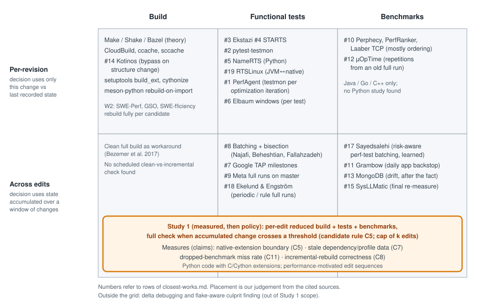

# W1-LIT — Methods literature for reduced build and test validation

**Status:** v3.2, final for the advisor meeting, 2026-11-21. Start with [literature-in-one-page.md](literature-in-one-page.md). v3.1 added the Peass venue and testmon PyPI metadata. v3.2 adds the ACM DL and IEEE Xplore searches (123 records screened, [database-search-2026-11-21.md](database-search-2026-11-21.md)), which moved C7 to partial. Reframed after the advisor-persona review and PM rulings:
- claims are restructured around evidence;
- PerfAgent, Fallahzadeh 2025 and Sayedsalehi 2026 were read in full;
- forward citations of PerfAgent and NameRTS were screened;
- a positioning figure was added.

v2 had a critic pass (96 claims checked, 71 OK, all 25 flagged problems fixed; see the fix log below and `critic-report.md`).**Evidence boundary:** a targeted primary-source review, run 2026-11-21. It is **not** a systematic review: ACM DL and IEEE Xplore were searched (123 records screened), but not Scopus or Web of Science. Forward-citation screening covered only PerfAgent and NameRTS. Papers and documentation were read, not reproduced. Every claim is labelled:
- [R] read in source, with a section or page;
- [F] read through a web-fetch summary;
- [A] abstract or snippet only;
- [I] our inference;
- [U] unknown.

No novelty is claimed beyond "not found in our recorded searches".

## In one sentence

Study 1 measures **where existing deterministic build and test reduction becomes unsafe** when edits are performance-motivated and accumulate. The four suspected mechanisms are:
- native-extension boundaries (C5);
- dependency and profile data going stale across edits (C7);
- dropped benchmarks (C11);
- incremental-rebuild correctness (C8).

It then tests whether simple rules aimed at those mechanisms close the gap at matched cost (RQ3).

*Rows: decisions made per revision versus decisions made across edits. Columns: build, tests, benchmarks. Numbers refer to [closest-works.md](closest-works.md).*

## What's new compared with Ekstazi, STARTS, testmon and incremental builds? (the advisor's question)

**We do not propose a better selector.**

The closest system, PerfAgent (arXiv 2607.19653, read in full), already runs pytest-testmon on every optimization iteration. It never runs the full suite and never reports what the selection misses. Its authors say native-extension regressions "can slip between iterations" (§VI).

The gap is **evidence of when these techniques fail** in this setting:

| Claim | What existing tools assume | Why our setting breaks it | Status of the search |
|---|---|---|---|
| **C5** native boundary | Coverage sees the changed code | Optimizations move work into C/Cython; coverage.py sees Python lines only | Not found for Python. PerfAgent names it; RTSLinux shows the JVM analogue. |
| **C7** stale dependency data | Dependency maps were recorded on the current baseline | Reduced runs refresh only the tests that ran; maps age over a chain of edits | Partial. Chittimalli & Harrold (TSE 2009) show outdated coverage harms selection for one version step. No measurement over a growing refresh interval. |
| **C11** dropped benchmarks | Benchmarks covering the change will show it | Coverage is not sufficient (Ding: 74–77% show no speed-up); dropped benchmarks miss slowdowns | Partial: ordering studied; Grambow reports misses (Go). |
| **C8** incremental rebuild | Declared dependencies are complete | setuptools and Cython rebuild by mtime and ignore flags and directives [F] | Not found for Python extensions. |

**The RQ3 policy follows from these findings.** It has three parts:
- rules aimed at each mechanism (native fallback, dependency refresh, profile-based benchmarks with a sentinel set, a clean-vs-incremental check);
- a full check when accumulated change crosses a threshold;
- a cap at k edits.

**We concede that the trigger is a deterministic variant of risk-mass batching** (Sayedsalehi 2026, "-la" strategies). Claim C1 covers only its model-free, two-tier form on chains of dependent edits, compared with fixed-k at matched cost.

**Not new, and not claimed:**
- per-edit test selection in optimization loops (PerfAgent);
- a two-sided speed-up and no-regression gate (SemOpt, PerfAgent);
- periodic full runs (Meta, Google);
- batching, bisection, and variable or risk-based batch size (Najafi, Fallahzadeh 2025, Sayedsalehi 2026);
- comparison with a stable baseline (MongoDB);
- culprit finding (deferred).

**NameRTS as a comparator.** Public code exists at https://github.com/ZJU-CTAG/NameRTS. It is Apache-2.0, holds two commits from 2026-05-20, and targets conda and Python 3.13. It is a replication package: each project needs a hand-built environment, and there is no documented command for running it on any pytest repository. Nobody here has run it (`notes/R3`).

Details: [closest-works.md](closest-works.md) (22 works) and [beyond-literature-claims.md](beyond-literature-claims.md). The claims file has four main claims, four supporting claims and four struck. Each claim carries its search and the W3 evidence it needs.

## Files

| File | Content |
|---|---|
| [literature-in-one-page.md](literature-in-one-page.md) | One-page advisor summary: 4 mechanisms, 5 closest works, what we do not claim |
| [review.md](review.md) | Narrative synthesis: §1 builds, §2 functional RTS, §3 performance testing, §4 safety evaluation, §5 batching and culprit finding, §6 synthesis |
| [taxonomy.md](taxonomy.md) | Technique tables: what is reduced, granularity, safety assumption, overhead, Python support |
| [assumptions-under-iterative-optimization.md](assumptions-under-iterative-optimization.md) | 16 assumptions that break under performance-motivated, accumulating edits, each testable by W3 (the novelty area) |
| [candidate-rules.md](candidate-rules.md) | Deterministic rules B1–B6, F1–F8, P1–P8, C1–C6 for W3, each traced to sources and mapped to RQ3 parts (a), (b), (c) |
| [closest-works.md](closest-works.md) | 22 closest works: what each does, overlap, difference; the answer to the advisor's question |
| [beyond-literature-claims.md](beyond-literature-claims.md) | Main claims C5/C7/C11/C8 and supporting claims C1/C6/C3/C2, each with search, result and the W3 evidence needed. Struck claims C4/C9/C10 are listed with reasons. |
| [figures/positioning.svg](figures/positioning.svg) | Positioning figure: per-revision vs across-edit decisions × build/tests/benchmarks |
| [database-search-2026-11-21.md](database-search-2026-11-21.md) | ACM DL and IEEE Xplore queries, hit counts, 123 screened records with relevance calls |
| [gap-and-search-log.md](gap-and-search-log.md) | Architect gap searches G1–G7, pointers to researcher logs, what was not read, corrections to the brief |
| [references.bib](references.bib) | 136 BibTeX entries: merged from `notes/T*.bib` (duplicates removed), plus entries added after the critic pass and the v3 reads. Fields marked in `note` where verified only from search metadata |
| [papers/](papers/) + [papers/download-sources.json](papers/download-sources.json) | 72 open-access PDFs with URL, date, sha256. Three are university course-page mirrors (flagged `host_note`). One non-author blog copy was removed. |
| [notes/](notes/) | Source cards T1–T5; full reads R1 (PerfAgent), R2 (Fallahzadeh 2025, Sayedsalehi 2026, agentic survey) and R3 (forward citations, NameRTS artifact); `W2-intake.md` holds the W2 findings used here |

## How to read
- Building the experiment (W3): `candidate-rules.md`, then the "What W3 measures" section.
- Judging novelty (advisor): the section above, then `closest-works.md` and `beyond-literature-claims.md`.
- Checking a claim: follow its citation key to the `notes/T*` source card for the passage and location.

## Fix log after the critic pass (2026-11-21)
| Critic ID | Fix |
|---|---|
| F1 | "Only Python RTS study" narrowed to "only Python-specific, fine-grained" study. BabelRTS and pytest-rts are now named (review §2.3, §6). |
| F2 | C1 cost formula corrected to 1 + P·2·log2 k. |
| F3 | Daly et al. now described as having *abandoned* the stable-release comparison after up to 99% false positives (P5, assumption B3, closest-works #13). |
| F4 | NameRTS select-all narrowed to side-effecting import-time functions, 5 of 50 matplotlib commits (A5, F6). |
| F5 | Three works added to closest-works and the claims: Sayedsalehi 2026 (#17), Ekelund & Engström (#18) and RTSLinux (#19). Gligoric et al. CAV 2014 added to claim C7 (the critic had said ISSTA; search shows CAV). |
| F7–F12 | Locations corrected: BuildFS 237/247, caching Obs. 1.1, Kotinos §9, ptrace §V-E, Luo §3, Gruber Abstract/§IV. |
| F13–F18 | Bib fixed: Kalibera duplicate merged, `perfbisect2022` replaced by `ocariza2022bisection`, ISSRE and ASE venues added, EASE booktitle added. Peass venue confirmed in v3.1: IEEE QRS 2022, pp. 916–925, DOI 10.1109/QRS57517.2022.00096. |
| F19 | 16 short citation forms replaced by full keys. |
| F20 | Duplicate RTSCheck PDF removed (68 PDFs). |
| F21–F22 | Uber kept as [R per T5 card, not re-checkable]; Orso downgraded to [F]. |
| F23 | PyCG recall upgraded to [R]. |
| F24 | Closed in v3.1: PyPI JSON re-fetched 2026-11-21. pytest-testmon 2.3.1, `requires_python >=3.11`, "Development Status :: 4 - Beta", summary "selects tests affected by changed files and methods". Upload date 2026-11-19 is from the fetch summary, not verbatim. |

## Changes in v3 (PM rulings, 2026-11-21)
- **Reframed** around measured mechanisms (C5, C7, C11, C8). The policy now follows from them, and the "contribution is the combination" framing is removed.
- **Struck:** C4 (folded into C11), C9, C10, and the two-sided oracle point.
- **C1 narrowed:** the trigger is conceded as a variant of Sayedsalehi 2026 risk-mass batching.
- **Full reads** added to closest-works (rows 1, 8, 17, 20):
  - PerfAgent: no full-suite run, no reported misses, native-extension hole.
  - Fallahzadeh 2025: variable batch vs selection as alternatives; combining them is future work.
  - Sayedsalehi 2026: cumulative-risk flush with caps.
  - The agentic survey: LLM-judged test selection is "unsound".
- **Forward citations:** PerfAgent has 7 citers, none of which selects tests or benchmarks. NameRTS has 1 (FastCI). Both papers are still v1.
- **NameRTS artifact** located (see above).
- **Positioning figure** added.
