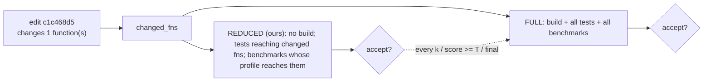

# Worked edit — step 10: FULL vs reduced validation (PRELIMINARY)

**Edit:** `c1c468d5` — Optimize _build_paths_from_predecessors stack logic for 30-40% speedup (#8460)
**State:** S9 → S10 (`52b7255a`); replayed source diff only (readiness §2).
**Changed functions (bth.changed_fns):** `networkx/algorithms/shortest_paths/generic.py::_build_paths_from_predecessors`

**Evidence boundary:** every selection below uses only data observed at S0 (before this edit), so there is no hindsight. This is a **single-edit view**: it applies each rule to this one edit with S0 data. It is not the session simulation, where A4 accumulates changed functions since its last full check and uses checkpoint data.
- Costs are *estimated seconds*: per-test serial durations and per-benchmark FULL-protocol wall time, both from S0 (readiness §5).
- End-to-end adds the build and the measured median pytest startup.
- Raw inputs: `raw/networkx/{depmap,oracle-tests,bench,profile,changes,testmon}/` and `sim/networkx/inputs/`.

## Step by step

1. **Diff → changed functions.** `bth.changed_fns` parses old/new ASTs; a function is changed if a changed line falls in its span (rules.md §1).
2. **Build.** FULL runs `pip install -e` (about 1.35 s; RQ1). This is a pure-Python edit, so the reduced arms skip the build (B1).
3. **Test selection.** Each arm applies its rule (rules.md §3) to the S0 observations.
4. **Benchmark selection.** Each arm applies its rule (rules.md §4).
5. **Decision.** Tests pass/fail, plus the asv rule on the selected benchmarks (rules.md §5).

## Selections and estimated cost for this edit

| Arm | Build | Tests run | Est. test s | **Est. end-to-end tests s** (+ build + 13.6 s pytest startup) | Benchmarks run | Est. bench s |
|---|---|---|---|---|---|---|
| A0 FULL | clean `pip install -e` | 6768 | 71.05 | 85.99 | 171 | 1667.73 |
| A2 testmon (PerfAgent-style) | none (pure Python, B1) | 20 | 0.01 | 13.61 | 171 | 1667.73 |
| A3 changed-module | none | 28 | 0.01 | 13.61 | 0 | 0.00 |
| A5 static-bench (+testmon tests) | none | 20 | 0.01 | 13.61 | 171 | 1667.73 |
| A4 single-edit view (no accumulation; S0 depmap + S0 profile) | none | 38 | 0.02 | 13.62 | 1 | 2.49 |

Tests selected by A4 that are not in A3: 10. Tests in A3 that are not in A4: 0.
Static reach (A5) selects 171/171 benchmark cases. Profile reach (A4) selects 1.

**Reading:** test *execution* drops from about 71 s to about 0.02 s. End-to-end, though, the reduced arms still pay about 13.6 s of pytest startup, so the drop is about 86 s to about 14 s (about 6x), not 3500x. Benchmarks dominate: one FULL benchmark pass costs 659–2444 s (median about 730 s) across 6 measured passes (2 processes; noisy or concurrent; results.md, RQ1 headline). Benchmark seconds in the table are from the noisy S0 pass (item 4).

**A4 as simulated in the session** (`sim/networkx/rq2_steps.csv`, arm OURS, step 10): its last full check was step 8, so it runs **71 tests** (accumulated since step 8) and **171/171 benchmark cases**, because profiles older than the last checkpoint count as unknown under P8 (finding B2). The single-edit row above matches the ablation without accumulation (`OURS:accumulate=False`: 38 tests).

**Caveat.** This is one edit, shown to explain the mechanism. Costs and misses over the whole session are in `results.md` (RQ2/RQ3).
